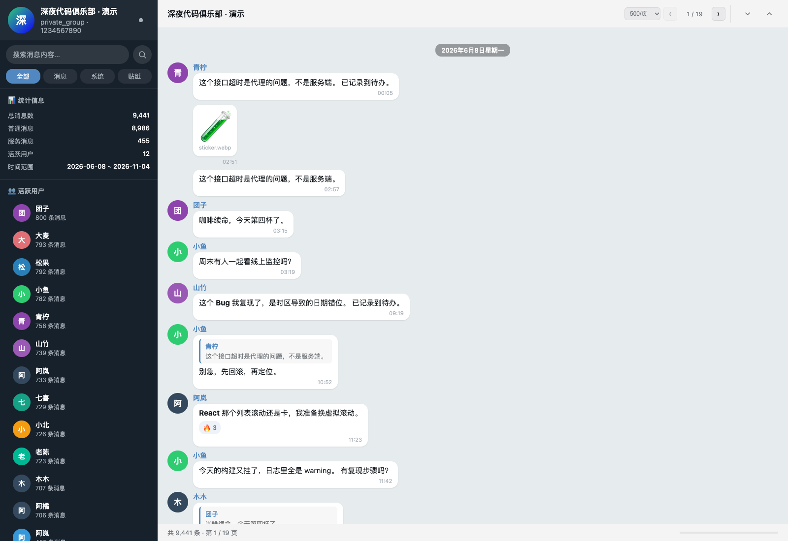

# TG-Chat-to-SQL

> Telegram 群聊导出 JSON → SQLite：增量导入、CSV / Parquet 导出、可交互时间轴热力图，以及能流畅浏览几万条消息的虚拟滚动聊天查看器。

Telegram Desktop 可以把群组聊天导出成 JSON，但原始 JSON 不适合查询和分析。本项目把这条链路一次做通：

**JSON → SQLite（去重增量）→ CSV / Parquet → 热力图 / 时间轴 → Telegram 风格聊天查看器**




## 核心能力

| 能力 | 说明 |
|------|------|
| 增量导入 | 去重键 `chat_id:message_id`，重复导入 0 新增；旧版数据库自动迁移 |
| 多群共存 | Telegram 消息 ID 只是群内序号，不同群相同 ID 不会互相覆盖 |
| 数据导出 | CSV（Excel 友好，UTF-8 BOM）与 Parquet（数据分析友好），支持群组 / 日期过滤 |
| 可交互时间轴 | 每日趋势图支持滑块缩放、滚轮缩放、近 7 / 30 / 90 天快捷区间；统计、关键词、时段、用户榜同步联动 |
| 大数据浏览 | 分页 + 虚拟滚动 + 动态高度测量，只渲染可视窗口；9,441 条消息时 DOM 中约 15 个消息节点 |
| 可视化 | 7×24 活跃度热力图、话题热力图、时段画像、用户排行 |
| 隐私 | 全本地处理，不上传任何数据；真实 `*.json` / `*.db` 已被 `.gitignore` 排除 |
| 离线可用 | ECharts 已内置于 `heatmap_visualization/vendor/`，无需外网 CDN |

## 快速开始

环境要求：Python 3.9+（GUI 仅依赖标准库）。

```bash
git clone https://github.com/SuHu4088/TG-Chat-to-SQL.git
cd TG-Chat-to-SQL

# 可选依赖：jieba（更准确的中文分词）、pyarrow（Parquet 导出）
pip install -r requirements.txt
```

### 1. 导入 Telegram JSON

```bash
# GUI：选择 JSON 与数据库路径，后台线程导入并显示进度
python importer_gui/main.py

# 或命令行
python sql_converter/json_to_sqlite.py --json result.json --db telegram_chat.db
```

再次执行同一条命令即可验证增量导入：`新增 0`、`跳过重复 N`，数据库总数不变。

### 2. 校验去重结果

```bash
python sql_converter/verify_db.py --db telegram_chat.db
```

输出会包含 `唯一去重键`、`重复键`、`孤儿文本实体` 与 `校验结果`。

### 3. 导出 CSV / Parquet

```bash
python sql_converter/export_data.py --db telegram_chat.db --format csv --output messages.csv
python sql_converter/export_data.py --db telegram_chat.db --format parquet --output messages.parquet \
  --start 2026-01-01 --end 2026-03-01
```

导出字段：`message_key / chat_id / message_id / message_type / date / date_unixtime / sender_name / sender_id / text_content / reply_to_message_id / forwarded_from / media_type / text_entities`。

### 4. 热力图与时间轴

```bash
python heatmap_visualization/data_processor.py --input result.json --output heatmap_visualization/processed_data.json
python heatmap_visualization/run.py
# 打开 http://localhost:8090
```

时间轴操作：

- 拖动每日趋势图下方滑块，或使用鼠标滚轮缩放；
- 点击「近 7 天 / 近 30 天 / 近 90 天 / 全部」快速切换；
- 区间变化后，顶部统计、关键词、时段画像和用户榜会同步只统计该区间；
- 点击某一天仍可下钻到当日详情。

### 5. 聊天查看器

```bash
cp result.json chat_viewer/chat_data.json
cd chat_viewer && python -m http.server 8091
# 打开 http://localhost:8091
```

- 每页条数可切换 `200 / 500 / 1000 / 2000`；
- 上一页 / 下一页按页跳转，列表本身使用虚拟滚动，只渲染可视区域；
- 支持全文搜索、用户筛选、回复跳转与深色模式。

## 演示数据（完全虚构）

```bash
# 生成 400 条示例，用于仓库内演示
python scripts/generate_demo_data.py --messages 400 --out examples/demo_chat.json

# 生成 8,000 条，用于性能与截图验证
python scripts/generate_demo_data.py --messages 8000 --days 150 --out /tmp/demo_large.json
```

`examples/demo_chat.json` 中的所有昵称、群名、消息均为随机虚构内容，不含真实聊天记录。

## 数据库设计（Schema v2）

```sql
CREATE TABLE messages (
    row_id INTEGER PRIMARY KEY AUTOINCREMENT,
    message_key TEXT NOT NULL UNIQUE,  -- chat_id:message_id
    id INTEGER NOT NULL,               -- Telegram 群内消息 ID
    chat_id TEXT NOT NULL,
    message_type TEXT NOT NULL,
    date TEXT,
    date_unixtime INTEGER,
    sender_name TEXT,
    sender_id TEXT,
    text_content TEXT,
    reply_to_message_id INTEGER,
    forwarded_from TEXT,
    media_type TEXT,
    raw_json TEXT,
    content_hash TEXT
);

CREATE TABLE text_entities (
    id INTEGER PRIMARY KEY AUTOINCREMENT,
    message_key TEXT NOT NULL,
    entity_type TEXT NOT NULL,
    entity_text TEXT,
    FOREIGN KEY (message_key) REFERENCES messages(message_key) ON DELETE CASCADE
);
```

为什么不用 `messages.id` 做主键：Telegram 的消息 ID 只是“群内序号”，两个群都会出现 `id=1`。使用 `chat_id:message_id` 作为唯一键，才能既支持多群合并，又让重复导入可验证。

旧版 v1 数据库在首次打开时自动迁移：重命名旧表、回填 `message_key`、重建文本实体关联，不需要手工操作。

## 项目结构

```
TG-Chat-to-SQL/
├── importer_gui/              # tkinter 导入器 + DatabaseManager + JSONImporter
├── sql_converter/             # CLI 导入 / 导出 / 校验
│   ├── json_to_sqlite.py
│   ├── export_data.py         # CSV / Parquet
│   └── verify_db.py
├── heatmap_visualization/     # ECharts 热力图 + 时间轴
│   ├── data_processor.py
│   ├── vendor/echarts.min.js  # 本地 ECharts，离线可用
│   └── index.html
├── chat_viewer/               # 虚拟滚动聊天查看器
├── scripts/generate_demo_data.py
├── tests/                     # 增量导入 / 迁移 / 导出单测
├── examples/demo_chat.json    # 虚构演示数据
├── docs/                      # 需求、设计、API、测试与截图
├── RequirementsSpec.md
├── SystemDesign.md
├── APISpec.md
├── TestPlan.md
└── CHANGELOG.md
```

## 文档

- [需求规格](RequirementsSpec.md)
- [系统设计](SystemDesign.md)
- [API 规格](APISpec.md)
- [测试计划](TestPlan.md)
- [更新日志](CHANGELOG.md)
- [现状盘点（2026-11-05）](docs/现状盘点-2026-11-05.md)

## 测试

```bash
python -m unittest discover -s tests -v
```

覆盖：首次导入、二次导入零新增、文本实体不重复、跨群相同消息 ID、v1 → v2 自动迁移、CSV 导出、日期过滤、Parquet 导出（未安装 pyarrow 时自动跳过）。

浏览器侧验证：`window.__viewer.getState()` 可读取实际渲染节点数；`window.__heatmap.getState()` 可读取当前时间轴区间。

## 隐私与安全

- 所有处理均在本地完成，不收集、不上传数据；
- `*.db`、`result.json`、`chat_viewer/chat_data.json` 等真实数据不会进入版本库；
- 演示数据、截图与示例全部使用虚构内容；
- 请勿把含真实成员信息的导出文件提交到公开仓库。

## 许可证

[MIT License](LICENSE)

## 更新日志

见 [CHANGELOG.md](CHANGELOG.md)。当前版本 **v1.1.0**（2026-11-05）。
