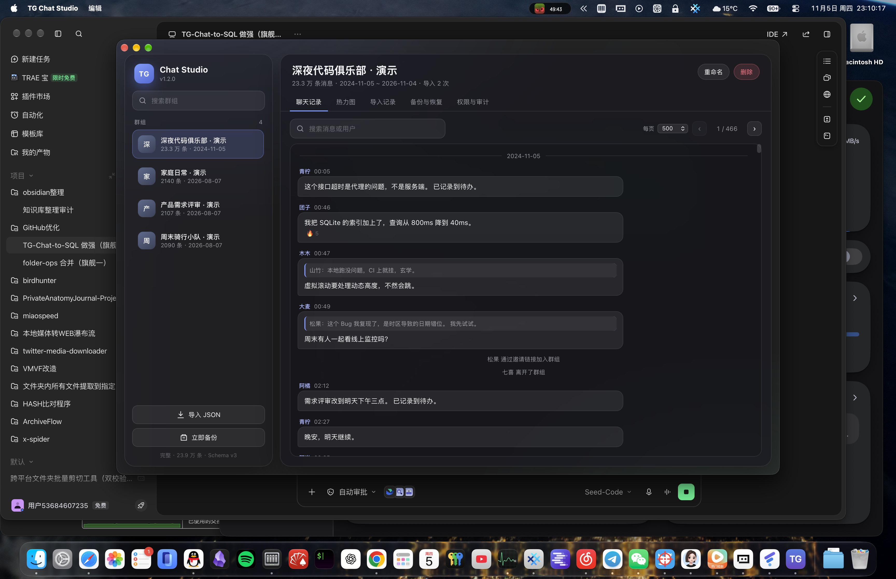

# TG Chat Studio（TG-Chat-to-SQL）

> 把 Telegram 群聊导出的 `result.json` 变成一个可查询、可备份、可浏览的本地聊天数据库。
> macOS 原生毛玻璃桌面应用，默认深色，20 万条消息下滚动依然流畅。

**JSON → SQLite（统一库、多群分区、增量去重）→ 桌面查看器 / 热力图 → CSV / Parquet**



## 核心能力

| 能力 | V1.2.0 说明 |
|------|-------------|
| 双击即用 | macOS arm64 `.app`，内置 Python 运行时，不需要装 Python、不需要命令行 |
| 真实毛玻璃 | AppKit `NSVisualEffectView`（`behindWindow`）采样桌面内容，不是纯色背景假装玻璃 |
| 默认深色 | 强制 `NSAppearanceNameDarkAqua`，不跟随系统浅色设置 |
| 统一多群库 | 单个 `.db`，`chats` 表 + `messages.chat_id` 分区 + 复合索引 |
| 群管理 | 群列表、切换、重命名、删除、每群统计、每群导入记录 |
| 增量去重 | 唯一键 `chat_id:message_id`，重复导入新增 0 条 |
| 流式导入 | 逐个解析 `messages` 数组，内存占用与文件大小基本无关 |
| 大数据浏览 | 服务端分页 + 前端虚拟滚动 + 动态高度测量，只渲染可视窗口 |
| 备份与回滚 | 手动/定期快照、sha256 + `integrity_check` 校验、恢复二次确认、保留策略 |
| 删除闸门 | 启动时无删除能力，输入确认短语后才授权；可撤销；全程审计日志 |
| 可视化 | 7×24 活跃度热力图、每日趋势（可缩放时间轴）、用户排行 |
| 隐私 | 全本地处理，不上传；真实数据文件已被 `.gitignore` 排除 |

## 快速开始

### 方式一：下载 `.app`

1. 从 [Releases](https://github.com/SuHu4088/TG-Chat-to-SQL/releases) 下载 `TG-Chat-Studio-v1.2.0-arm64.zip`；
2. 解压后把 `TG Chat Studio.app` 拖到「应用程序」；
3. 首次打开如提示「无法验证开发者」，右键 → 打开，或在终端执行：

```bash
xattr -d com.apple.quarantine "/Applications/TG Chat Studio.app"
```

> 本版本为 ad-hoc 签名、未做 Apple 公证。原因是公证需要付费开发者账号与凭据，属于必须由项目所有者拍板的事项，已在「遗留项」中说明。

### 方式二：源码运行

```bash
git clone https://github.com/SuHu4088/TG-Chat-to-SQL.git
cd TG-Chat-to-SQL
python3 -m venv .venv && .venv/bin/pip install -r requirements.txt
.venv/bin/python -m app.main          # 原生窗口
python3 -m core.server --port 8765    # 或者只开浏览器调试模式
```

浏览器调试模式打开 `http://127.0.0.1:8765`，与桌面 App 共用同一套本地 API。

## 使用流程

1. **导入**：左下角「导入 JSON」选择 Telegram 导出的 `result.json`（支持一次选多个群的文件）；
2. **切换群**：左侧群列表按最近活跃排序，点击即可切换；
3. **看统计**：顶部「热力图」页有 7×24 活跃度、每日趋势与用户排行；
4. **备份**：「备份与恢复」页手动创建快照；恢复需要输入 `RESTORE <快照名>`；
5. **删除**：默认不可用。到「权限与审计」输入 `ENABLE DELETE` 授权后，才会解锁删除按钮；随时可撤销。

## 性能实测（Apple M5 Pro / 64 GB / macOS 27.0.1）

测试数据为脚本生成的 **232,707 条虚构消息**（103 MB JSON），不是 9,441 条的外推。

| 指标 | V1.1.0（旧网页查看器） | V1.2.0（新桌面应用） |
|------|------------------------|----------------------|
| 导入耗时 | 4.04 s | 3.63 s |
| 导入峰值内存 | 1.21 GiB | 35.6 MB |
| 数据库体积 | 181 MB | 181 MB |
| 首屏渲染 | 372.6 ms | 84.6 ms（两次复测 84.6 / 105.3 ms） |
| 滚动平均帧率 | 60.1 FPS | 60.0 FPS |
| P95 帧率 / 帧耗时 | 59.5 FPS / 16.8 ms | 59.9 FPS / 16.7 ms |
| JS 堆占用 | 197.0 MB | 5.2 MB → 8.2 MB |
| DOM 消息节点 | 14–22 | 14 |
| 深分页（OFFSET 100000，500 条） | 82.7 ms（仅 SQL） | 27.4 ms（仅 API）/ 122.4 ms（界面端到端） |
| 重复导入（0 新增） | — | 1.77 s |

优化手段：Schema v3 复合索引、流式 JSON 解析、批量去重写入、服务端分页、前端虚拟滚动 + 动态高度测量。详见 [SystemDesign.md](SystemDesign.md)。

## 数据库设计（Schema v3）

```sql
CREATE TABLE chats (
    chat_id TEXT PRIMARY KEY,
    title TEXT NOT NULL,
    original_name TEXT,
    chat_type TEXT,
    created_at TEXT,
    updated_at TEXT
);

CREATE TABLE messages (
    row_id INTEGER PRIMARY KEY AUTOINCREMENT,
    message_key TEXT NOT NULL UNIQUE,   -- chat_id:message_id
    chat_id TEXT NOT NULL,
    id INTEGER NOT NULL,                -- Telegram 群内消息 ID
    message_type TEXT NOT NULL,
    date TEXT,
    date_unixtime INTEGER,
    sender_name TEXT,
    sender_id TEXT,
    text_content TEXT,
    reply_to_message_id INTEGER,
    forwarded_from TEXT,
    media_type TEXT,
    raw_json TEXT,
    content_hash TEXT
);

-- 关键索引
CREATE UNIQUE INDEX idx_messages_key ON messages(message_key);
CREATE INDEX idx_messages_chat_date ON messages(chat_id, date_unixtime, row_id);
CREATE INDEX idx_messages_chat_id ON messages(chat_id, id);
CREATE INDEX idx_messages_chat_sender ON messages(chat_id, sender_name);
```

为什么用 `chat_id:message_id` 做主键：Telegram 的消息 ID 只是群内序号，两个群都会出现 `id=1`。复合键既支持多群合并，也让重复导入可验证。

v1 / v2 数据库在首次打开时自动迁移到 v3，不需要手工操作。

## 项目结构

```
TG-Chat-to-SQL/
├── app/
│   ├── main.py                # AppKit + WKWebView 原生壳（毛玻璃 / 深色 / 文件桥）
│   └── web/                   # 前端：深色玻璃 UI、虚拟滚动、ECharts
├── core/
│   ├── db.py                  # Schema v3、多群、分页查询、完整性校验
│   ├── importer.py            # 流式 JSON 解析 + 批量去重写入
│   ├── backup.py              # 快照 / 校验 / 恢复 / 保留策略
│   ├── security.py            # 删除权限闸门 + 审计
│   ├── server.py              # 127.0.0.1 HTTP API + 静态资源
│   ├── paths.py / logging_setup.py
├── scripts/
│   ├── build_app.py           # PyInstaller 打包 arm64 .app
│   ├── make_icon.py           # 纯代码生成图标
│   ├── generate_demo_data.py  # 虚构演示数据（支持多群）
│   ├── bench_viewer.py        # 旧查看器基线测量
│   ├── bench_studio.py        # 新界面实测
│   └── shot_studio.py         # Playwright 截图与状态导出
├── sql_converter/             # CLI 导入 / CSV / Parquet 导出 / 校验（兼容保留）
├── chat_viewer/               # V1.1 网页查看器（兼容保留）
├── heatmap_visualization/     # V1.1 热力图（兼容保留）
├── importer_gui/              # V1.1 Tkinter 导入器（兼容保留，不再作为主入口）
├── tests/                     # 30 个单测
├── docs/                      # 截图、现状盘点、开发文档
├── RequirementsSpec.md
├── SystemDesign.md
├── APISpec.md
├── TestPlan.md
└── CHANGELOG.md
```

## 命令行工具（兼容保留）

```bash
python sql_converter/json_to_sqlite.py --json result.json --db telegram_chat.db
python sql_converter/verify_db.py --db telegram_chat.db
python sql_converter/export_data.py --db telegram_chat.db --format csv --output messages.csv
python sql_converter/export_data.py --db telegram_chat.db --format parquet --output messages.parquet \
  --start 2026-01-01 --end 2026-03-01
```

## 演示数据（完全虚构）

```bash
# 单个群 400 条
python scripts/generate_demo_data.py --messages 400 --out examples/demo_chat.json

# 5 个群，每群 1,800 条
python scripts/generate_demo_data.py --chats 5 --messages 1800 --days 90 --out /tmp/multi/demo_chat_1.json

# 20 万条压测数据
python scripts/generate_demo_data.py --messages 232000 --days 730 --out /tmp/bench/big.json
```

所有昵称、群名、消息内容均为随机虚构，不含任何真实聊天记录或身份信息。

## 文档

- [需求规格](RequirementsSpec.md)
- [系统设计](SystemDesign.md)
- [API 规格](APISpec.md)
- [测试计划](TestPlan.md)
- [更新日志](CHANGELOG.md)
- [V1.2.0 现状盘点](docs/现状盘点-v1.2.0.md)

## 测试

```bash
python3 -m pytest tests/ -q
```

覆盖：多群隔离、重复导入零新增、跨群相同消息 ID、流式导入、群重命名/删除、删除权限默认关闭与授权/撤销、审计日志、快照创建/校验/恢复/保留策略、v1→v3 迁移、CSV/Parquet 导出。

## 隐私与安全

- 所有处理均在本地完成，`API` 只监听 `127.0.0.1`；
- `*.db`、`result.json` 等真实数据不会进入版本库；
- 演示数据、截图与示例全部使用虚构内容；
- 删除能力默认关闭，所有删除尝试（包括被拒绝的）都会写入 `logs/audit.jsonl`。

## 许可证

[MIT License](LICENSE)

## 更新日志

见 [CHANGELOG.md](CHANGELOG.md)。当前版本 **v1.2.0**（2026-11-05）。
