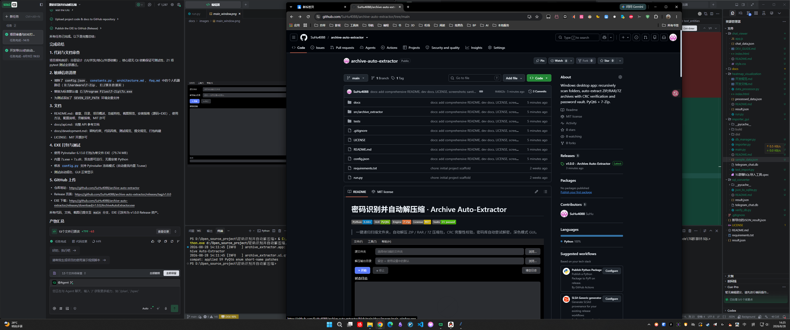
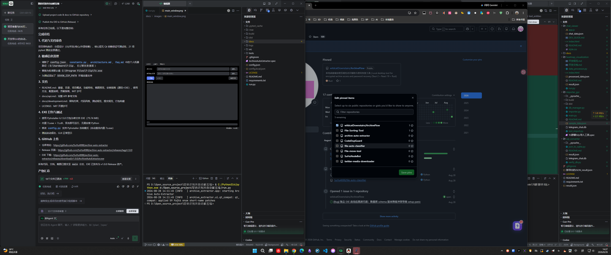
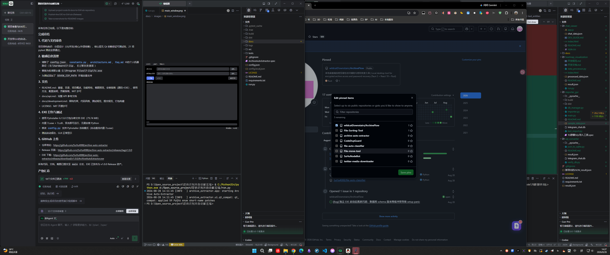
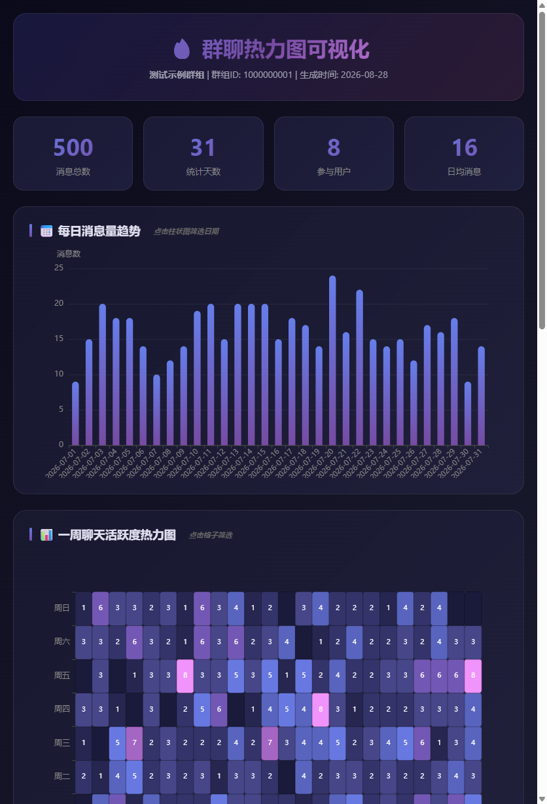

# 📨 TG 群聊转 SQL

> 将 Telegram 导出的群聊 JSON 数据，转换为结构化 SQLite 数据库，并提供可视化分析工具。

Telegram 桌面端支持将群组/频道聊天记录导出为 JSON 格式，但原始 JSON 不便查询与分析。本项目提供一整套工具链：**JSON → SQLite 转换**、**暗色主题 GUI 导入器**、**热力图可视化**与**Telegram 风格聊天查看器**，让群聊数据的存储、查询、统计与可视化一站式完成。

---

## ✨ 功能特性

- 🗄️ **JSON → SQLite 转换** — 将 Telegram 导出的 JSON 结构化为带索引的 SQLite 数据库，支持消息、文本实体、回复链、转发、媒体类型等完整字段
- 🖥️ **暗色主题 GUI 导入器** — 基于 tkinter 的现代化界面，支持文件选择、预览、进度显示、统计面板与导入历史
- 🔁 **智能去重 & 增量导入** — 基于消息 ID 去重，同一 JSON 可反复导入，多个时间段导出可增量合并，零重复
- 📊 **数据统计** — 消息总数、普通/服务消息、独立用户、回复/转发数、文本实体数，实时展示
- 🔥 **热力图可视化** — 7×24 活跃度热力图、话题关键词、每日趋势、用户排行（基于 ECharts）
- 💬 **Telegram 风格查看器** — 纯前端实现，还原 Telegram 聊天界面，支持深色模式、全文搜索、用户筛选、回复跳转
- 📦 **开箱即用 EXE** — 提供独立可执行文件，无需安装 Python 即可运行

---

## 🖼️ 项目截图

### GUI 导入工具 — 暗色主题



### 数据统计面板



### 导入历史



### 热力图可视化



### Telegram 风格聊天查看器


---

## 📁 项目结构

```
TG群聊转SQL/
├── importer_gui/              # 🖥️ GUI 导入工具（主程序 / EXE 入口）
│   ├── main.py                #   GUI 主程序入口
│   ├── db_manager.py          #   数据库管理模块
│   ├── importer.py            #   JSON 导入核心逻辑（含去重）
│   ├── test_import.py         #   测试脚本
│   ├── sample_data.json       #   合成示例数据（无真实隐私）
│   └── README.md              #   模块文档
│
├── sql_converter/             # 🗄️ 命令行转换工具
│   ├── json_to_sqlite.py      #   JSON → SQLite 转换脚本
│   ├── verify_db.py           #   数据库验证脚本
│   └── README.md              #   模块文档
│
├── heatmap_visualization/     # 🔥 热力图可视化
│   ├── data_processor.py      #   数据处理脚本（分词 + 统计）
│   ├── run.py                 #   本地服务器启动脚本
│   ├── index.html             #   热力图可视化页面
│   ├── 开发文档.md             #   开发文档
│   ├── 开发规范.md             #   开发规范
│   └── README.md              #   模块文档
│
├── chat_viewer/               # 💬 Telegram 风格聊天查看器
│   ├── index.html             #   页面主结构
│   ├── style.css              #   样式表（含深色模式）
│   ├── app.js                 #   核心逻辑
│   ├── DEV_GUIDE.md           #   开发规范文档
│   └── README.md              #   模块文档
│
├── docs/                      # 📖 项目文档
│   ├── 开发文档.md             #   架构设计 / 模块说明 / API / 开发规范
│   └── screenshots/           #   项目截图
│
├── .gitignore                 # 忽略规则（含敏感数据保护）
├── requirements.txt           # Python 依赖
├── LICENSE                    # 开源许可证
└── README.md                  # 本文档
```

> ⚠️ **注意**：`*.db`、`result.json`、`chat_data.json` 等真实聊天数据文件已被 `.gitignore` 排除，不会提交至仓库。`importer_gui/sample_data.json` 为合成的无隐私示例数据。

---

## 🚀 安装指南

### 方式一：下载 EXE（推荐，无需安装 Python）

1. 前往本仓库 [Releases](../../releases) 页面
2. 下载最新版的 `TG群聊SQL导入工具.zip`
3. 解压后双击 `TG群聊SQL导入工具.exe` 即可运行

### 方式二：从源码运行

**环境要求**：Python 3.8+

```bash
# 1. 克隆仓库
git clone https://github.com/<你的用户名>/TG群聊转SQL.git
cd TG群聊转SQL

# 2.（可选）安装依赖
pip install -r requirements.txt

# 3. 启动 GUI 导入工具
cd importer_gui
python main.py
```

> GUI 导入工具仅使用 Python 标准库（tkinter / sqlite3 / json），无需额外依赖。
> 热力图分词功能可选安装 `jieba` 以获得更好的中文分词效果。

---

## 📖 使用方法

### 1. GUI 导入工具（`importer_gui`）

```bash
cd importer_gui
python main.py
```

**操作步骤**：

1. **选择数据库路径** — 使用默认路径或点击「浏览...」自定义，首次运行自动建库建表
2. **选择 JSON 文件** — 点击「选择JSON」，选中从 Telegram 导出的 `.json` 文件，程序自动预览群组信息与消息数
3. **开始导入** — 点击「🚀 开始导入」，程序在后台线程执行，自动识别新消息并跳过已存在的消息
4. **查看结果** — 导入完成后可在「数据统计」与「导入历史」标签页查看详情

### 2. 命令行转换（`sql_converter`）

```bash
cd sql_converter
# 将 Telegram 导出的 result.json 放入本目录
python json_to_sqlite.py
# 生成 telegram_chat.db

# 验证数据库内容
python verify_db.py
```

### 3. 热力图可视化（`heatmap_visualization`）

```bash
cd heatmap_visualization
# 将 result.json 放入本目录
python data_processor.py        # 生成 processed_data.json
python run.py                   # 启动本地服务器，自动打开浏览器
```

### 4. 聊天记录查看器（`chat_viewer`）

将 Telegram 导出的 JSON 重命名为 `chat_data.json` 放入 `chat_viewer/` 目录，然后：

```bash
# 方式一：直接双击 index.html 打开（部分浏览器可能受 CORS 限制）
# 方式二：启动本地服务器
cd chat_viewer
python -m http.server 8080
# 访问 http://localhost:8080
```

---

## 🗄️ 数据库设计

SQLite 数据库包含 4 张表：

| 表名 | 说明 |
|------|------|
| `chat_info` | 群组信息（名称、类型、ID） |
| `messages` | 消息主表（ID、类型、日期、发送者、文本、回复、转发、媒体、原始JSON） |
| `text_entities` | 文本实体（关联消息，类型 + 文本片段） |
| `import_log` | 导入日志（时间、文件名、总数、导入数、跳过数、状态） |

关键字段说明：

- `messages.id` — 直接使用 Telegram 消息 ID，天然主键，便于去重与溯源
- `messages.raw_json` — 保存完整原始 JSON 对象，兜底字段，便于后续扩展
- `text_entities` — 复杂文本（含格式/链接/表情）拆分存储，`text_content` 仅存纯文本

索引设计：

```sql
CREATE INDEX idx_messages_chat_id    ON messages(chat_id);
CREATE INDEX idx_messages_sender_id  ON messages(sender_id);
CREATE INDEX idx_messages_date       ON messages(date_unixtime);
CREATE INDEX idx_entities_message_id ON text_entities(message_id);
```

常用 SQL 查询示例见 [开发文档](docs/开发文档.md#常用-sql-查询示例)。

---

## 🛠️ 技术栈

| 组件 | 技术 | 说明 |
|------|------|------|
| GUI | tkinter | Python 标准库，暗色主题，跨平台 |
| 数据库 | SQLite3 | 嵌入式数据库，WAL 模式，外键约束 |
| 数据处理 | Python 3 | JSON 解析、分词（jieba 可选）、统计 |
| 可视化 | ECharts 5 | 热力图、柱状图、折线图 |
| 前端查看器 | HTML5 + CSS3 + 原生 JS | 无框架依赖，响应式布局 |
| 打包 | PyInstaller | 生成独立 EXE |

---

## 🧪 测试

```bash
cd importer_gui
python test_import.py
```

测试覆盖：首次导入（全新数据库）、二次导入（去重验证）、数据验证（统计与历史）。

---

## 🤝 贡献说明

欢迎提交 Issue 和 Pull Request！

1. Fork 本仓库
2. 创建特性分支：`git checkout -b feature/your-feature`
3. 提交更改：`git commit -m 'feat: add your feature'`（遵循 [约定式提交](https://www.conventionalcommits.org/)）
4. 推送分支：`git push origin feature/your-feature`
5. 提交 Pull Request

**贡献规范**：

- 遵循 PEP 8 代码风格，使用类型注解（Type Hints）
- 模块化设计，单一职责
- 不提交真实聊天数据、数据库文件或任何敏感信息
- 新增功能需附带测试

---

## ⚠️ 安全与隐私

- 本项目**不收集、不上传**任何数据，所有处理均在本地完成
- 真实聊天数据（`.json`、`.db`）已通过 `.gitignore` 排除，不会进入版本库
- `sample_data.json` 为合成数据，不含任何真实个人信息
- 请勿将包含真实隐私的导出文件提交至公开仓库

---

## 📄 许可证

本项目基于 [MIT License](LICENSE) 开源。

---

## 📝 更新日志

### v1.0.0 (2026-07-28)
- 初始版本发布
- JSON → SQLite 转换（命令行 + GUI）
- 智能去重与增量导入
- 暗色主题 GUI 界面
- 数据统计与导入历史
- 热力图可视化
- Telegram 风格聊天查看器
